## Hi, I'm Schariac125 👋

An ordinary undergraduate at Fuzhou University. I spend most of my time learning, and the rest writing about whatever catches my attention.

- 🌱 Currently learning **Golang** and **Agent**
- 🧩 Also exploring **full-stack development** and **product design**
- ✍️ Writing about code and everything else on my [blog](https://schariac125.github.io/)
- 📫 Reach me at [schariac125@gmail.com](mailto:schariac125@gmail.com)

     

中文

一名福州大学的普通本科生。大部分时间在学东西，剩下的时间写点自己感兴趣的文字。

- 🌱 现在在学 **Golang**、**Agent**
- 🧩 也在尝试 **全栈开发**、**产品设计**
- ✍️ 代码以内、以外的东西都写在[博客](https://schariac125.github.io/)
- 📫 欢迎来信：[schariac125@gmail.com](mailto:schariac125@gmail.com)

日本語

福州大学の普通の学部生です。ほとんどの時間を学ぶことに使い、残りは気になったことを書いています。

- 🌱 いま学んでいること：**Golang**、**Agent**
- 🧩 挑戦していること：**フルスタック開発**、**プロダクトデザイン**
- ✍️ コードに限らず、いろいろなことを[ブログ](https://schariac125.github.io/)に書いています
- 📫 メール：[schariac125@gmail.com](mailto:schariac125@gmail.com)

### 📊 GitHub

  <picture>
    <source media="(prefers-color-scheme: dark)" srcset="https://raw.githubusercontent.com/Schariac125/Schariac125/output/snake-dark.svg" />
    <source media="(prefers-color-scheme: light)" srcset="https://raw.githubusercontent.com/Schariac125/Schariac125/output/snake.svg" />
    
  </picture>

GitHub stats

 

  

> 愿我们都能在文字与代码之间，找到属于自己的宁静与热爱。
